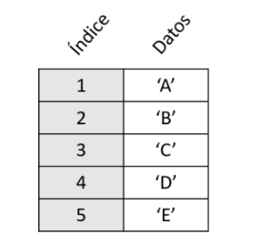
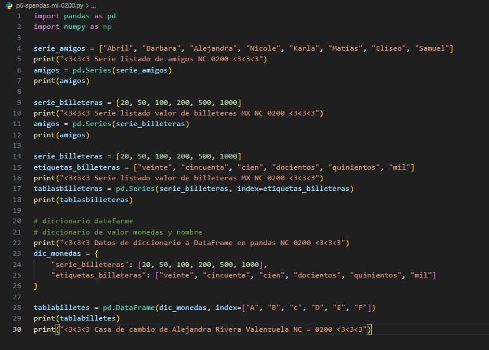
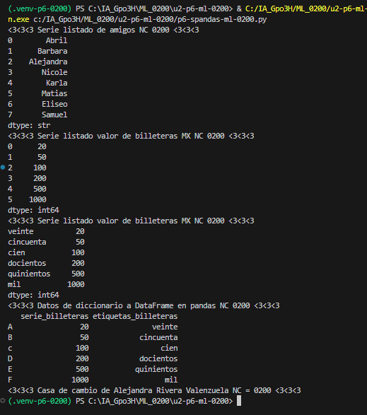

## ¿Qué es una Serie?
Es la estructura más simple que proporciona Pandas, y se asemeja a una columna en una hoja de cálculo de Excel.

Son estructuras unidimensionales que contienen un array de datos (de cualquier tipo soportado por NumPy). Un objeto Series tiene dos componentes principales:

índice: contiene valores únicos y, por lo general ordenados. Se usan para acceder a valores individuales de los datos.

vector: contiene los datos.

## codigo 

## resultado 

 ## Alejandra Rivera Valenzuela NC = 0200